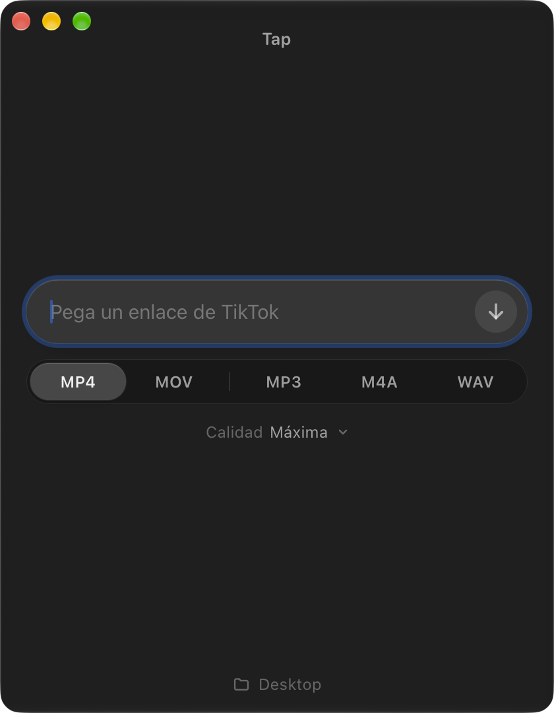
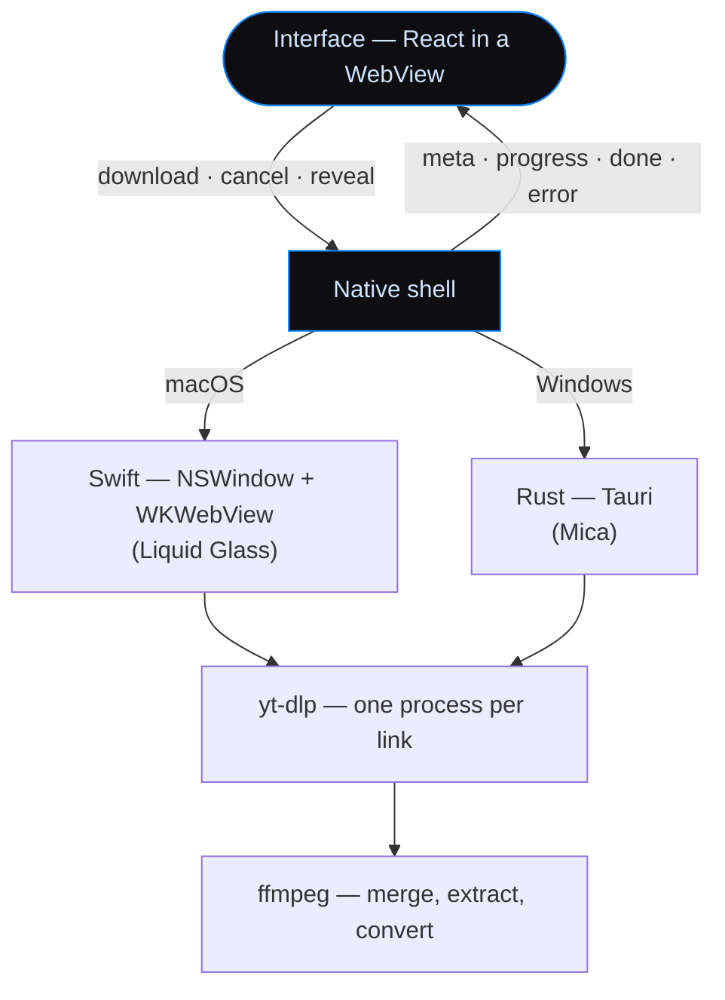

<p align="center">
  
</p>

<p align="center">
  
  
  
  
</p>

Paste a link, get the file. Tap downloads video or audio from YouTube,
Instagram, TikTok, X and pretty much any other site, in a small native
window with nothing else in it: a field for the link, the format, the
quality, and where it goes.

Under the hood it's [yt-dlp](https://github.com/yt-dlp/yt-dlp) and
[ffmpeg](https://ffmpeg.org). Tap just puts a quiet face on them.

<p align="center">
  
</p>

## Index

- [Why](#why)
- [Installation](#installation)
- [Usage](#usage)
- [Formats and quality](#formats-and-quality)
- [Windows](#windows)
- [How it fits together](#how-it-fits-together)
- [Known limitations](#known-limitations)
- [License](#license)

## Why

yt-dlp can download almost anything, but it lives in the terminal and every
download means remembering flags. Most graphical front ends go the other
way and show every option yt-dlp has. Tap keeps only the decisions you
actually make:

- **One field.** Paste, drop or type a link; the arrow button (or Enter)
  starts it. Several links at once work too.
- **Five formats**: MP4, MOV, MP3, M4A and WAV, each one remembering its
  own quality.
- **Files that just open.** Videos come out as H.264 + AAC, so QuickTime
  and Finder previews play them without a codec hunt.
- **Native, not Electron.** A real macOS window with Liquid Glass behind
  the interface, at a fixed width that only grows taller.

## Installation

On the Mac, Tap uses yt-dlp and ffmpeg from Homebrew, so install those first:

```sh
brew install yt-dlp ffmpeg
```

Then download the latest `Tap.dmg` from [Releases](../../releases), open it,
and drag `Tap.app` into `Applications`. It needs Apple Silicon and macOS 13
or later.

> [!IMPORTANT]
> Tap isn't notarized by Apple (that needs a paid Developer account), so the
> first time macOS will refuse to open it. Go to **System Settings → Privacy &
> Security**, scroll down and click **Open Anyway**. You only need to do this
> once. Or, from the terminal: `xattr -dr com.apple.quarantine /Applications/Tap.app`.

To build it yourself instead:

```sh
brew install yt-dlp ffmpeg node
git clone https://github.com/alexcalatyd/Tap.git
cd Tap
./build.sh --install
open -a Tap
```

That builds the interface, compiles the app, draws its icon, signs it
ad hoc and installs it into `/Applications`. Besides Homebrew it only needs
the Xcode command line tools (`xcode-select --install`). Built on your own
machine, Gatekeeper doesn't get in the way.

> [!NOTE]
> Tap doesn't bundle yt-dlp or ffmpeg: it uses the ones Homebrew installs in
> `/opt/homebrew/bin`. Keep yt-dlp fresh with `brew upgrade yt-dlp` — sites
> change often and an old version is the usual reason a download fails.

## Usage

1. Copy a link and paste it into the field (or drag it in from the browser).
2. Pick a format and, if you want, a quality.
3. Press the arrow or Enter.

Each download gets a row with its thumbnail, title and a progress ring.
Click a finished one to show it in Finder; a failed one can be retried, and
one in progress cancelled. The folder button at the bottom changes where
files go (Downloads by default) and is remembered.

You can also hand it a link from the terminal, and it starts on launch:

```sh
open -a Tap --args "https://www.youtube.com/watch?v=…"
```

The interface speaks Spanish and English. It starts in your system's
language; the small code in the bottom-right corner (`ES` / `EN`) switches
it, menus included, and remembers your choice.

## Formats and quality

The quality picker sits under the format bar, as a small menu with a
slider.

| Format | Quality steps | Default |
|---|---|---|
| **MP4**, **MOV** | 480p, 720p, 1080p, Maximum | Maximum |
| **MP3** | 128, 192, 320 kbps | 320 kbps |
| **M4A** | 64, 96 kbps, Original | Original |
| **WAV** | 44.1 kHz, 48 kHz | 44.1 kHz |

## Windows

There's a Windows version built with [Tauri](https://tauri.app), sharing
the same interface. Download `Tap_x.y.z_x64-setup.exe` from
[Releases](../../releases) and run it: it installs for your user only, no
admin rights needed. GitHub Actions also builds a fresh installer on every
change, attached to the run as the `Tap-Windows` artifact.

- yt-dlp and ffmpeg are **downloaded on first use** into
  `%LOCALAPPDATA%\local.tap\bin` (about 130 MB, once). yt-dlp updates
  itself every few days.
- Mica on Windows 11, the system accent color, and its own window buttons.
- Videos fall back to H.264, trying the GPU encoders (NVENC, Quick Sync,
  AMF) before the CPU.

> [!NOTE]
> The installer isn't signed, so SmartScreen warns the first time: click
> **More info → Run anyway**.

## How it fits together



- `native/main.swift` — the Mac app: window, glass, the yt-dlp runner, the
  destination folder and the compatibility check for videos.
- `native/icon.swift` — draws the app icon.
- `ui/` — the interface, shared by both platforms: Vite, React, TypeScript
  and Tailwind. `npm run dev` inside it runs it in a browser with simulated
  downloads.
- `windows/` — the Tauri app; `src-tauri/src/main.rs` mirrors the Swift
  side.
- `build.sh` — builds `build/Tap.app`; `--install` copies it to
  `/Applications`.

<details>
<summary><b>Why videos sometimes get re-encoded</b></summary>
<br>

YouTube often serves VP9 video with Opus audio. Inside an `.mp4`, QuickTime
won't play that: you get sound and a black frame. So MP4 and MOV ask yt-dlp
to prefer H.264 and AAC (`-S "res:N,vcodec:h264,acodec:aac"`). When a site
simply doesn't offer them, Tap checks the result with `ffprobe` and
re-encodes only the track that needs it — HEVC through VideoToolbox on the
Mac, H.264 on Windows (HEVC there is a paid extension).

</details>

<details>
<summary><b>How the interface talks to the app</b></summary>
<br>

The interface sends small messages — `download`, `cancel`, `reveal`,
`chooseFolder` — through `window.webkit.messageHandlers` on the Mac and
Tauri's `invoke` on Windows. The native side answers by calling
`window.__native(event)` with `meta`, `progress`, `part`, `done` or
`error`. Progress comes from yt-dlp's own `--progress-template`, read line
by line, so there's no output scraping guesswork.

</details>

<details>
<summary><b>Components</b></summary>
<br>

The format bar, drop zone and quality slider are built on
[React Aria](https://react-spectrum.adobe.com/react-aria/), and the
progress ring is adapted from [Magic UI](https://magicui.design). The link
field is Tap's own: on send, the text is redrawn on a canvas, sampled into
motes and blown away from the last letter to the first.

</details>

## Known limitations

- **Mac: Apple Silicon only**, and yt-dlp and ffmpeg have to come from
  Homebrew.
- Not notarized on the Mac, and the Windows installer isn't signed: both
  warn the first time (see [Installation](#installation) and
  [Windows](#windows)).
- Playlists aren't supported: a playlist link downloads just the one video.
- Sites that need you to be logged in won't work; Tap doesn't use your
  browser's cookies.

## License

MIT — see [LICENSE](LICENSE). yt-dlp, ffmpeg and the adapted components
keep their own licenses: see [THIRD_PARTY_NOTICES.md](THIRD_PARTY_NOTICES.md).

What you download, and what you do with it, is up to you: respect each
site's terms and the copyright of what you save.
